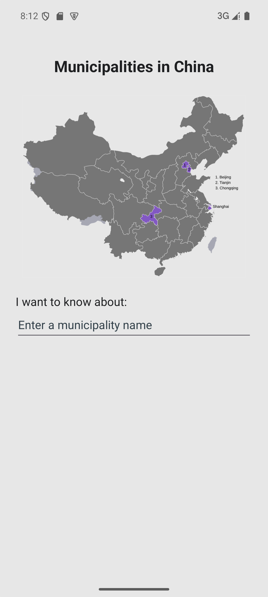
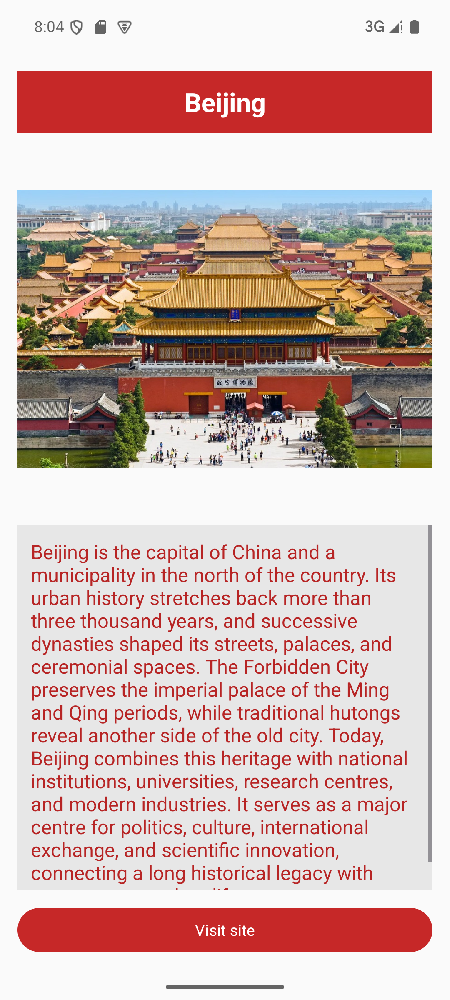
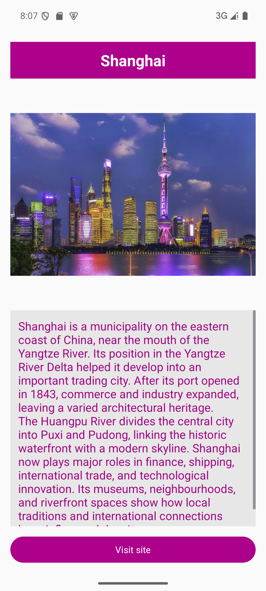
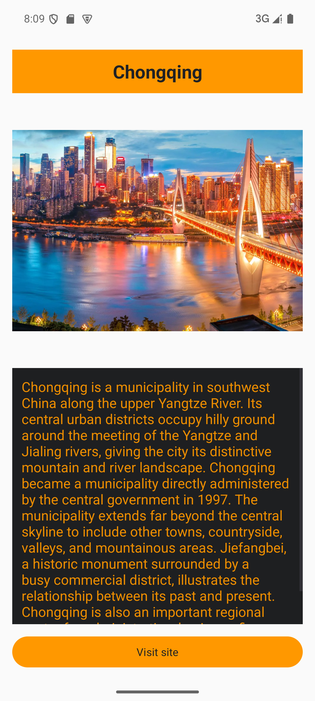
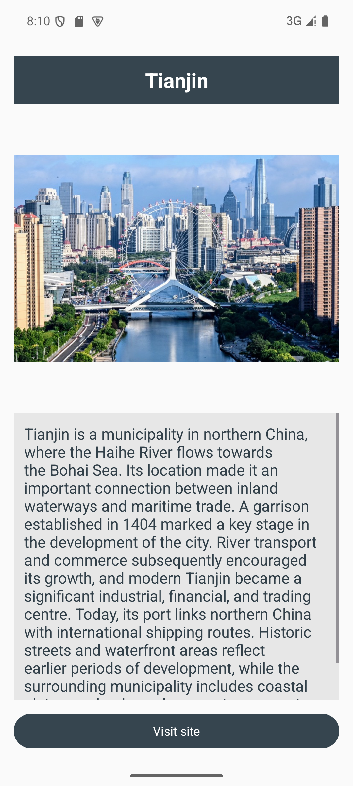

# Chinese Municipalities — Practical 5

Student ID: **20243007024**. Android Studio project: **PracticalFive**.

A Java and XML Android app for exploring Beijing, Shanghai, Chongqing, and Tianjin. Enter an English city name on the map screen and press the keyboard Go/Enter action. The detail screen shows its photograph, an original researched summary, and city-specific colours. **Visit site** opens that city's official website through an implicit ACTION_VIEW intent.

## Run

1. Open this repository's root folder in Android Studio (the folder containing `settings.gradle.kts`, not the inner app module).
2. Use the IDE's bundled JDK and install Android SDK Platform 37 if prompted. Let Gradle sync finish.
3. Select the app run configuration and an emulator or device running Android 7.0 / API 24 or higher, then Run.
4. Try `BEIJING`, `Shanghai`, `tianjin`, and `ChOnGqInG`. Unsupported names, empty input, and whitespace-only input show an error without leaving the main page.

The project was built with Android Gradle Plugin 9.4.1, Gradle 9.6.0, and Android Studio's JBR 25. The Gradle wrapper is included. `local.properties` is intentionally ignored; Android Studio generates the SDK path for each machine.

## Implementation

- `MainActivity.java`: single-line input, keyboard action handling, validation, and explicit navigation.
- `TextProcessor.java`: shared validation, whitespace trimming, and locale-independent case normalisation.
- `Municipality.java`: safe extra handling, city resource selection, dynamic colours, scrollable information, and official website navigation with an ActivityNotFoundException fallback.
- `UiInsets.java`: system bar, cutout, and keyboard spacing.
- XML layouts, named strings and colours, and `municipalities_array` provide reusable UI resources.
- The array order is **Beijing, Shanghai, Chongqing, Tianjin**, following the written requirement rather than the inconsistent sample order in the brief.
- Red, magenta, charcoal, and bright orange are used for the respective city title backgrounds, information text, and buttons. Chongqing's orange information text has a dark background for readability.
- Supplied images and logo are used. Adaptive, monochrome, round, and legacy launcher icons are included.

The app itself requires no network permission; web browsing is performed by the external browser. It stores no persistent user data. Internet access is needed only when the browser opens a website.

## Build and verify

From the repository root on Windows:

```powershell
.\gradlew.bat assembleDebug testDebugUnitTest lintDebug
.\gradlew.bat connectedDebugAndroidTest
```

Start an emulator or connect an Android device before the second command. On macOS/Linux use `./gradlew` (make it executable with `chmod +x gradlew` if necessary).

Normally, APKs and reports are generated under `app/build`. On Windows, if the checkout path contains non-ASCII characters, the build automatically places generated output in `<Gradle user home>/practicalfive-build/<checkout hash>/app`. This avoids a reproduced Java launcher/Gradle test-classpath encoding failure while leaving source files in the selected project folder. Android Studio's Build output links to the generated files.

Four JVM tests and six device tests cover the required valid/invalid inputs, resource mapping, original summary lengths, colours and images, activity recreation, invalid extras, exact website intents, and simulated missing-browser handling. See [test results](docs/TESTING.md) and [research sources](docs/SOURCES.md).

The five bitmap-location Lint warnings are narrowly excluded in `app/lint.xml` because the assignment explicitly requests those images in `res/drawable`. Images are proportionally resized to a maximum dimension of 900 pixels to bound density-scaled bitmap memory.

## Screenshots

| Main | Beijing | Shanghai | Chongqing | Tianjin |
|---|---|---|---|---|
|  |  |  |  |  |

## Submission

Public repository URL for Canvas: **https://github.com/h1949-bb/20243007024-Practical5**

Development is recorded in incremental descriptive commits. The repository contains source, resources, the Gradle wrapper, tests, and documentation. Local SDK settings and build output are excluded.
